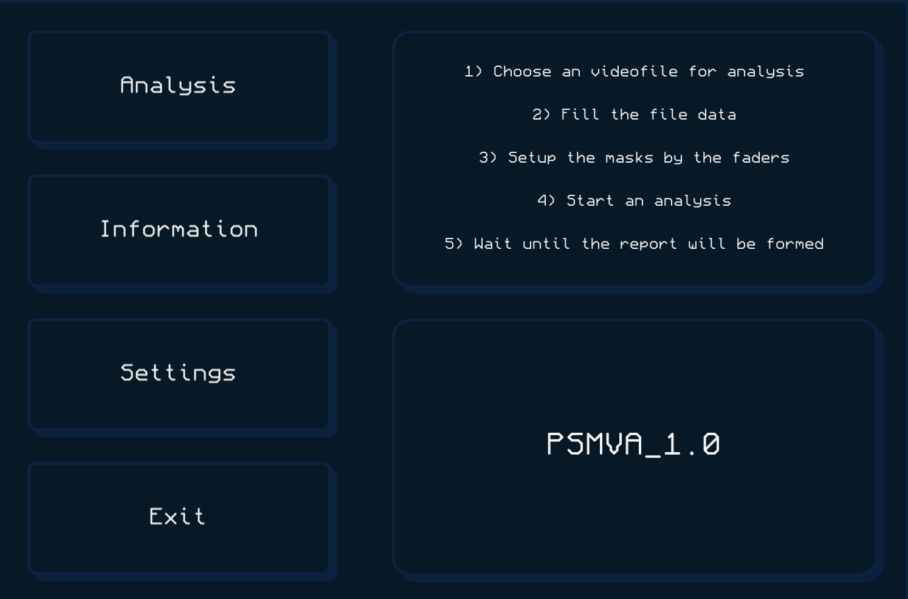
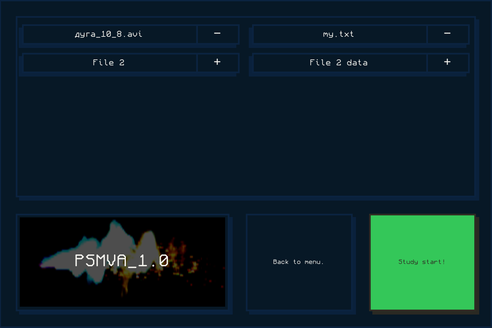
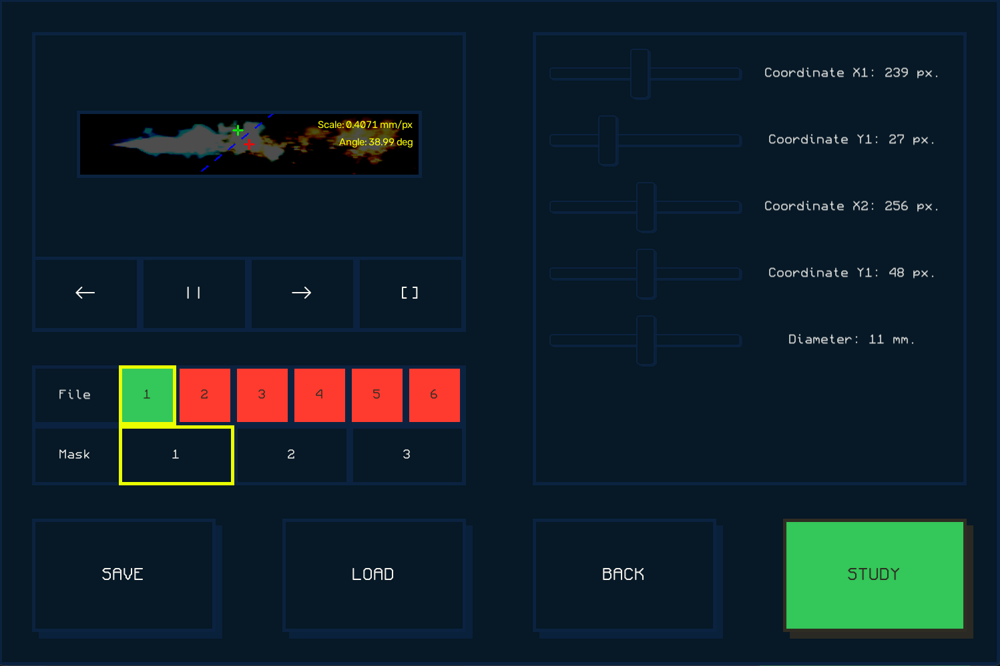

## **Plasma spraying video analysis application**

An application based on **CPP**, **OpenCV2**, and **SDL3** designed for analyzing high-speed video footage of plasma spraying processes (calculating characteristics of various flow components).

___

## **Workflow**

### The app allows you to select files and their metadata.

### Then it allows to configure OpenCV masks.

### It accepts videos with frames like this:

### Then it processes frames and generates a report with following format:
 
___

| Parameter                                     | Mode 1  | Mode 2  |   ...   | Mode N  |
|-----------------------------------------------|---------|---------|---------|---------|
| Radiation intensity, %                        |         |         |         |         |
| Delta radiation intensity, % / frame          |         |         |         |         |
| Jet width, mm                                 |         |         |         |         |
| Jet length, mm                                |         |         |         |         |
| Main trajectory angle, °                      |         |         |         |         |
| Deviation angle, °                            |         |         |         |         |
| Maximum deviation angle, °                    |         |         |         |         |
| Delta deviation angle, ° / frame              |         |         |         |         |
| Velocity of particles without deviation, m/s  |         |         |         |         |
| Velocity of deviated particles, m/s           |         |         |         |         |
| Delta particle velocity, (m/s) / frame        |         |         |         |         |
| Percentage of deviated particles, %           |         |         |         |         |

___

### More information is available inside the [diary](https://github.com/dimakomplekt/PSMVA/tree/main/diary)

___